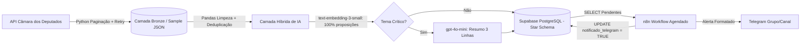

# 🧭 Bússola Pública — Inteligência Legislativa Automatizada

Pipeline completo de **Engenharia de Dados**, **Inteligência Artificial Híbrida (FinOps)** e **Automação** para monitoramento ativo da Câmara dos Deputados, desenvolvido pelo squad do programa de **Pós-Graduação em Engenharia de Dados, IA Generativa e Automação (XPeriun)**.

---

## 🎯 Problema de Negócio

Centenas de proposições legislativas, votações e registros de despesas parlamentares são publicados semanalmente na API de Dados Abertos da Câmara dos Deputados. Acompanhar manualmente o que impacta setores críticos — como **Tributário e Fiscal**, **Tecnologia e Inteligência Artificial** e **Saúde Pública** — é lento, oneroso e sujeito a pontos cegos.

O **Bússola Pública** resolve esse gargalo automatizando:
1. A coleta incremental e padronizada dos dados legislativos.
2. A modelagem dimensional em Data Warehouse (Star Schema).
3. A classificação temática universal via embeddings e sumarização executiva seletiva por IA.
4. O disparo de alertas idempotentes em tempo real via **Telegram**.

---

## 🛠️ Stack Tecnológica

* **Fonte de Dados:** API de Dados Abertos da Câmara dos Deputados (`/proposicoes`, `/deputados`, `/partidos`, `/votacoes`, `/despesas`).
* **Linguagem & ETL:** Python 3.10+ (`requests`, `pandas`, `psycopg2-binary`, `numpy`, `python-dotenv`).
* **Data Warehouse:** PostgreSQL hospedado no **Supabase** (modelagem Star Schema com `UPSERT` idempotente).
* **Camada de IA & FinOps:** OpenAI API (`text-embedding-3-small` para 100% das proposições + `gpt-4o-mini` acionado seletivamente apenas para temas críticos).
* **Orquestração & Alertas:** **n8n** com controle de idempotência (`notificado_telegram`) e bot integrado ao **Telegram**.

---

## 🏗️ Arquitetura da Solução



---

## 📂 Estrutura do Repositório

```text
bussola-publica/
├── data/
│   └── sample/                  # Amostras leves (.json) para testes locais sem sobrecarregar APIs
├── docs/                        # Diagramas, evidências e documentação complementar
├── n8n/                         # Workflows exportados (.json) do n8n
├── notebooks/                   # Notebooks exploratórios e de padronização (ETL)
│   ├── 01_extracao_api_camara.ipynb
│   └── 02_padronizacao.ipynb
├── sql/                         # Scripts DDL e migrations incrementais do Supabase
│   └── 00_fase0_init.sql        # Schema base (Fase 0)
├── src/                         # Scripts Python de extração, carga DW e pipeline de IA
│   └── etl_camara.py            # Extração e processamento inicial da API da Câmara
├── .env.example                 # Modelo de variáveis de ambiente
├── .gitignore                   # Bloqueio de segredos (.env), caches e ambientes virtuais
├── MANUAL_SQUAD.md              # Guia operacional, Git-flow e plano de 14 dias
├── README.md                    # Visão geral, arquitetura, execução e métricas do projeto
└── requirements.txt             # Dependências Python do projeto
```

---

## 🗄️ Modelo de Dados (Star Schema — Supabase / PostgreSQL)

### 📐 Tabelas Dimensão
* **`dim_partidos`**: `id_partido` (PK), `sigla`, `nome`, `status`, `atualizado_em`.
* **`dim_deputados`**: `id_deputado` (PK), `nome`, `sigla_partido`, `sigla_uf`, `url_foto`, `email`, `atualizado_em`.
* **`dim_tempo`**: `data_id` (PK), `ano`, `mes`, `dia`, `trimestre`, `dia_semana`.

### 📊 Tabelas Fato
* **`fato_proposicoes`**: `id_proposicao` (PK), `sigla_tipo`, `numero`, `ano`, `ementa`, `data_apresentacao`, `uri`, `tema_ia` (`VARCHAR(120)`), `similaridade_tema`, `is_tema_critico`, `resumo_executivo`, `notificado_telegram` (`BOOLEAN DEFAULT FALSE`), `notificado_em`.
* **`fato_votacoes`**: `id_votacao` (PK), `id_proposicao` (FK), `data_votacao`, `descricao`, `aprovacao`.
* **`fato_despesas`**: `id_despesa` (PK), `cod_documento` (UNIQUE), `id_deputado` (FK), `ano`, `mes`, `tipo_despesa`, `valor_documento`, `valor_glosa`, `valor_liquido`, `data_documento`, `nome_fornecedor`, `cnpj_cpf_fornecedor`, `url_documento`.

---

## 🚀 Como Rodar o Projeto Localmente

### 1️⃣ Pré-requisitos
* **Python 3.10+** instalado.
* **Git** configurado na máquina.
* Acesso ao projeto **Supabase** (ou PostgreSQL compatível) com o DDL da pasta `sql/` aplicado.
* Chave da **OpenAI API** (para execução da etapa de IA) e token de bot do **Telegram** (para alertas).

### 2️⃣ Instalação e Configuração
```bash
# 1. Clone o repositório
git clone https://github.com/lufernasilva/bussola-publica.git
cd bussola-publica

# 2. Crie e ative o ambiente virtual
python -m venv .venv
# Windows (PowerShell/CMD):
.venv\Scripts\activate
# Linux / macOS:
source .venv/bin/activate

# 3. Instale as dependências
pip install -r requirements.txt

# 4. Configure as variáveis de ambiente
cp .env.example .env
```
Edite o arquivo `.env` com suas credenciais reais (`DATABASE_URL`, `OPENAI_API_KEY`, `TELEGRAM_BOT_TOKEN`, `TELEGRAM_CHAT_ID`).

### 3️⃣ Inicialização do Banco de Dados
Execute os scripts da pasta `sql/` em ordem numérica no **SQL Editor** do Supabase (começando por `sql/00_fase0_init.sql`) para criar as tabelas dimensão, tabelas fato e o usuário de leitura.

### 4️⃣ Execução do Pipeline (Etapas)
```bash
# Etapa 1 & 2 — Extração da API da Câmara e carga UPSERT no Supabase
python src/etl_camara.py

# Etapa 3 — Classificação via Embeddings (100%) e Resumo Executivo (apenas temas críticos)
python src/ia_classificacao.py

# Etapa 4 — Orquestração e Alertas
# Importe o workflow de n8n/ na sua instância n8n, configure as credenciais e ative o agendamento.
```
*(Nota: Os notebooks em `notebooks/` documentam a extração e padronização iniciais; novos scripts em `src/` seguem as entregas das Etapas 2 e 3.)*

---

## 🧠 Decisões Técnicas & Camada de IA Híbrida (FinOps)

1. **Classificação Temática Universal (`text-embedding-3-small`)**: Todas as proposições têm suas ementas vetorizadas e comparadas por similaridade de cosseno contra temas de referência, garantindo cobertura de 100% da base com custo mínimo.
2. **Resumo Executivo Seletivo (`gpt-4o-mini`)**: Apenas proposições classificadas em **temas críticos** (`Tributário e Fiscal`, `Tecnologia e Inteligência Artificial`, `Saúde Pública`) acionam o LLM para gerar um resumo executivo de 3 linhas, otimizando tokens e mantendo o custo total abaixo de **US$ 0,50**.
3. **Idempotência Nativa no Banco (`notificado_telegram`)**: O fluxo n8n consulta apenas registros com `is_tema_critico = TRUE AND notificado_telegram = FALSE` e atualiza a flag imediatamente após o disparo no Telegram, impedindo alertas duplicados.
4. **Carga Incremental (`UPSERT`)**: Uso de `ON CONFLICT` no PostgreSQL preservando flags de notificação já enviadas.

### 💬 Prompt Utilizado no Resumo Executivo (`gpt-4o-mini`)
> *"Você é um analista legislativo sênior. Resuma a proposição legislativa abaixo em exatamente 3 linhas curtas, em linguagem clara e objetiva para um tomador de decisão executivo, destacando o objetivo principal e o possível impacto prático."*

---

## 👥 Organização do Squad (6 Integrantes)

O desenvolvimento segue um roadmap de **14 dias** dividido em 4 frentes paralelizáveis (detalhes completos no [`MANUAL_SQUAD.md`](./MANUAL_SQUAD.md)):

| Papel | Responsáveis | Escopo Principal |
| :--- | :--- | :--- |
| **Integrante 1 — Tech Lead / Governança** | Luiz Fernando | Setup Fase 0 (Supabase, OpenAI, GitHub), revisões de PRs, apoio transversal e consolidação final (`README.md` + validação read-only). |
| **Integrantes 2 e 3 — Engenharia de Dados (ETL & DW)** | **João Marcelo**<br>**Robson** | **Etapa 1:** Extração da API da Câmara, paginação e padronização *(entrega inicial de João Marcelo mergeada via PR)*; sequência com **Robson**.<br>**Etapa 2:** DDL incremental (`dim_tempo`, `fato_votacoes`, `fato_despesas`), carga `UPSERT` e usuário read-only. |
| **Integrantes 4 e 5 — IA & FinOps** | *A definir* | **Etapa 3:** Embeddings (`text-embedding-3-small`), filtro de temas críticos, resumos executivos (`gpt-4o-mini`) e métricas de custo. |
| **Integrante 6 — Automação & Alertas** | *A definir* | **Etapa 4:** Configuração do n8n, bot do Telegram, testes de idempotência e apoio na carga histórica final (**Etapa 5**). |

---

## 🔍 Acesso Somente Leitura ao Banco (30+ Dias de Dados)

* **Host:** `<PREENCHER_HOST_SUPABASE>`
* **Port:** `6543` (ou `5432`)
* **Database:** `postgres`
* **User (Read-Only):** `bussola_reader`
* **Password:** `<PREENCHER_SENHA_LEITURA>`

---

## 📈 Métricas & FinOps *(Atualizar na Etapa 5)*

* **Volume histórico ingerido:** *Pendente (Etapa 5)*
* **Proposições classificadas via Embeddings:** *Pendente (Etapa 5)*
* **Resumos gerados (`gpt-4o-mini` — temas críticos):** *Pendente (Etapa 5)*
* **Custo total estimado da execução:** *Pendente (Etapa 5)*