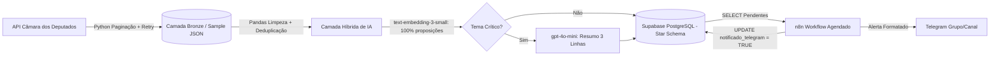

# 🧭 Bússola Pública — Inteligência Legislativa Automatizada

Pipeline completo de Engenharia de Dados, Inteligência Artificial Híbrida e Automação para monitoramento ativo da Câmara dos Deputados, desenvolvido pelo squad do programa de Pós-Graduação em Engenharia de Dados, IA Generativa e Automação (XPeriun).

---

## 🎯 Problema de Negócio

Centenas de proposições legislativas, votações e registros de despesas parlamentares são publicados semanalmente na API de Dados Abertos da Câmara dos Deputados. Acompanhar manualmente o que impacta setores críticos (como **Tributário e Fiscal**, **Tecnologia e Inteligência Artificial** e **Saúde Pública**) é lento e sujeito a pontos cegos.

O **Bússola Pública** automatiza a coleta, estruturação dimensional, classificação temática, sumarização executiva e entrega de alertas em tempo real via Telegram.

---

## 🏗️ Arquitetura da Solução



---

## 🗄️ Modelo de Dados (Star Schema — Supabase / PostgreSQL)

### Tabelas Dimensão
* **`dim_partidos`**: `id_partido` (PK), `sigla`, `nome`, `status`, `atualizado_em`.
* **`dim_deputados`**: `id_deputado` (PK), `nome`, `sigla_partido`, `sigla_uf`, `url_foto`, `email`, `atualizado_em`.
* **`dim_tempo`**: `data_id` (PK), `ano`, `mes`, `dia`, `trimestre`, `dia_semana`.

### Tabelas Fato
* **`fato_proposicoes`**: `id_proposicao` (PK), `sigla_tipo`, `numero`, `ano`, `ementa`, `data_apresentacao`, `uri`, `tema_ia` (`VARCHAR(120)`), `similaridade_tema`, `is_tema_critico`, `resumo_executivo`, `notificado_telegram` (`BOOLEAN DEFAULT FALSE`), `notificado_em`.
* **`fato_votacoes`**: `id_votacao` (PK), `id_proposicao` (FK), `data_votacao`, `descricao`, `aprovacao`.
* **`fato_despesas`**: `id_despesa` (PK), `cod_documento` (UNIQUE), `id_deputado` (FK), `ano`, `mes`, `tipo_despesa`, `valor_documento`, `valor_glosa`, `valor_liquido`, `data_documento`, `nome_fornecedor`, `cnpj_cpf_fornecedor`, `url_documento`.

---

## 🧠 Decisões Técnicas & Camada de IA Híbrida (FinOps)

1. **Classificação Temática Universal (`text-embedding-3-small`)**: Todas as proposições têm suas ementas vetorizadas e comparadas por similaridade de cosseno contra 10 temas de referência, garantindo cobertura de 100% da base com custo de centavos.
2. **Resumo Executivo Seletivo (`gpt-4o-mini`)**: Apenas proposições classificadas em **temas críticos** (`Tributário e Fiscal`, `Tecnologia e Inteligência Artificial`, `Saúde Pública`) acionam o LLM para gerar um resumo executivo de 3 linhas, otimizando tokens e mantendo o custo total abaixo de US$ 0,50.
3. **Idempotência Nativa no Banco (`notificado_telegram`)**: O fluxo n8n consulta apenas registros com `is_tema_critico = TRUE AND notificado_telegram = FALSE` e atualiza a flag imediatamente após o disparo no Telegram, impedindo alertas duplicados.
4. **Carga Incremental (`UPSERT`)**: Uso de `ON CONFLICT` no PostgreSQL preservando flags de notificação já enviadas.

### Prompt Utilizado no Resumo Executivo (`gpt-4o-mini`)
> *"Você é um analista legislativo sênior. Resuma a proposição legislativa abaixo em exatamente 3 linhas curtas, em linguagem clara e objetiva para um tomador de decisão executivo, destacando o objetivo principal e o possível impacto prático."*

---

## 🔍 Acesso Somente Leitura ao Banco (30+ Dias de Dados)

* **Host:** `<PREENCHER_HOST_SUPABASE>`
* **Port:** `6543` (ou `5432`)
* **Database:** `postgres`
* **User (Read-Only):** `bussola_reader`
* **Password:** `<PREENCHER_SENHA_LEITURA>`

---

## 🚀 Como Rodar Localmente

```bash
# 1. Clonar repositório e criar ambiente virtual
git clone <URL_DO_REPOSITORIO>
cd bussola-publica
python -m venv .venv
source .venv/bin/activate  # Linux/Mac
# .venv\Scripts\activate   # Windows

# 2. Instalar dependências e configurar variáveis
pip install -r requirements.txt
cp .env.example .env  # Preencher DATABASE_URL, OPENAI_API_KEY e TELEGRAM_*

# 3. Validar conexão com o Supabase
python -m src.db_connection

# 4. Gerar amostras (Dia 0) ou extrair carga histórica de 30+ dias
python -m src.extract_camara

# 5. Executar pipeline ETL + IA + Load
python -m src.pipeline_etl
```

---

## 👥 Divisão do Squad & Governança Git

* **Etapa 0 (Todos):** Setup do repositório, DDL (`sql/create_tables.sql`) e amostras em `data/sample/`.
* **Etapa 1 (Pessoa 1):** `README.md`, convenções de branches/PRs e governança.
* **Etapa 2 (Pessoa 2):** Modelagem DW no Supabase e módulo `src/db_connection.py`.
* **Etapa 3 (Pessoas 3 e 4):** Ingestão dos 5 endpoints (`src/extract_camara.py`) e Camada de IA Híbrida + FinOps (`src/ai_layer.py`).
* **Etapa 4 (Pessoa 5):** Bot oficial no Telegram e workflow n8n (`n8n/bussola_publica_workflow_template.json`).
* **Etapa 5 (Pessoa 6 + Todos):** Testes integrados ponta a ponta, diagrama Excalidraw e Pitch de 6 slides (`docs/ROTEIRO_PITCH_6_SLIDES.md`).
